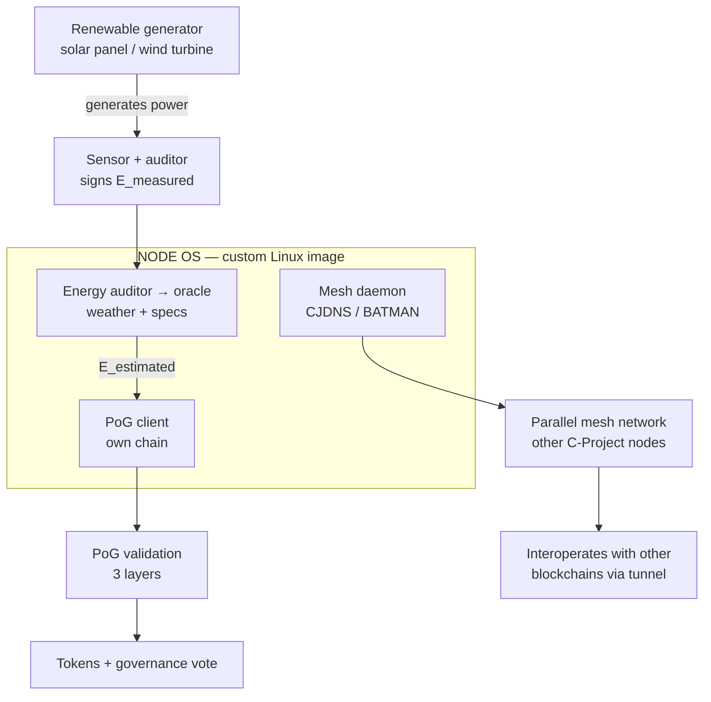
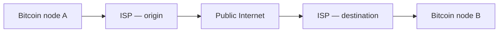
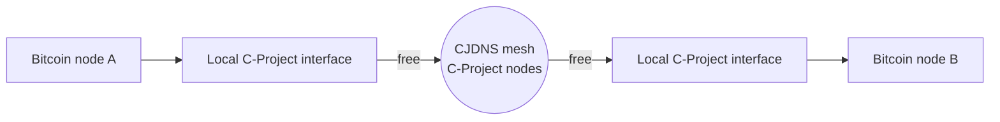

# How C-Project Works

This document gives a visual walkthrough of two mechanisms described in [`architecture.md`](architecture.md), [`PoG.md`](PoG.md) and [`os-and-parallel-network.md`](os-and-parallel-network.md): what runs inside a single node, and what happens when another blockchain's traffic — not C-Project's own — travels this network instead of the Internet.

An interactive version of these diagrams (clickable PoG detail, a toggle between "today" and "with C-Project") lives at [`assets/diagrams/how-it-works.html`](../📁%20assets/diagrams/how-it-works.html). GitHub does not run scripts when previewing an HTML file, so open it by downloading the file and loading it in a browser; the diagrams below render natively on GitHub without that step.

## 1. Anatomy of a node

One solar panel, one Raspberry Pi, but three services running inside a single Linux image (see [`os-and-parallel-network.md`](os-and-parallel-network.md) §2 for why it's one custom OS image and not separately installed software).

PoG validation (the only gate between "energy generated" and "reward paid", see [`PoG.md`](PoG.md)) works in three steps:

1. **Direct measurement** — the sensor measures the energy generated and cryptographically signs the reading.
2. **Contextual estimation** — the auditor combines the generator's GPS location and technical specs with weather data from an oracle to calculate how much energy it *should* have produced.
3. **Reconciliation** — if the measured and estimated values match within a tolerance band, the report is valid and paid out based on the measured value; otherwise it's flagged as suspicious and earns no reward.

## 2. Where another blockchain's traffic travels

This isn't about C-Project's own chain — it's about what changes when a node from *any other* blockchain uses this network instead of the Internet to talk to its peers.

**Today**, P2P traffic for any blockchain depends on ISP infrastructure at each end, which can filter, log, or cut it:

**With C-Project**, that same traffic is carried peer-to-peer across the encrypted CJDNS mesh formed by C-Project nodes; basic transport across it is free (see §3), and an Internet gateway still exists as an option, never a requirement:

## 3. What is free and what costs tokens

The network doesn't charge for existing; it charges for consuming another node's finite resources.

| Always free | Paid in tokens |
|---|---|
| Routing a message or a P2P connection through the mesh | Dedicated storage for a third party's data |
| Layer-0 access for any external blockchain | Sustained compute on a specific node |
| Discovery and addressing between nodes | Guaranteed bandwidth / SLA |
